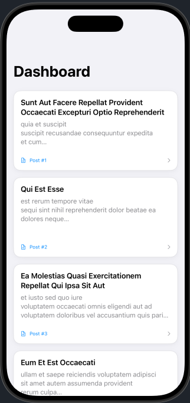
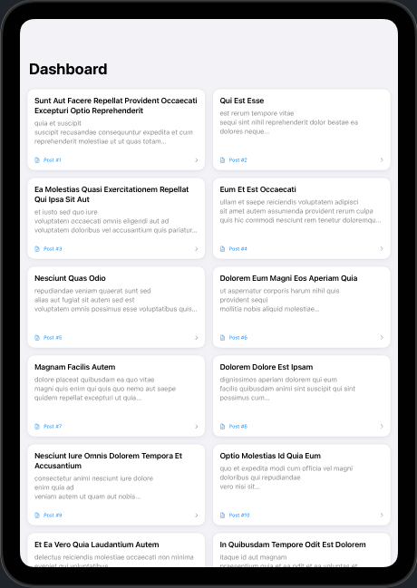

# Responsive Data-Driven Dashboard App

A modern, production-grade SwiftUI dashboard application built using Swift concurrency (`async/await`) and the `@Observable` macro. It consumes the public JSONPlaceholder API and features an adaptive multi-device layout that scales seamlessly from iPhone to iPad simulators.

---

## 📁 Project Directory Structure

```text
SwiftUIDashboard/
├── Models/
│   └── Post.swift             # Data model conforming to Codable & Identifiable
├── Services/
│   └── NetworkManager.swift   # Actor-based networking layer handling HTTP & decoding
├── ViewModels/
│   └── DashboardViewModel.swift # State management container using @Observable
├── Views/
│   └── DashboardMainView.swift  # Adaptive grid layout, loading, and error state views
├── screenshots/
│   ├── iphone_dashboard.png   # Single-column iPhone simulator capture
│   └── ipad_dashboard.png     # Multi-column iPad simulator capture
└── README.md                  # Comprehensive project documentation
```

---

## 🚀 Key Features & Technical Architecture

1. **Modern Swift Concurrency (`async/await`):**
   * Eliminates callback hell by utilizing modern asynchronous functions for fetching data over `URLSession`.
   * Built as an isolated `actor` (`NetworkManager`) to guarantee thread safety when performing network operations.

2. **Reactive State Management (`@Observable`):**
   * Leverages iOS 17+'s `@Observable` macro to manage reactive state transitions cleanly without legacy object wrapper boilerplate.
   * Gracefully isolates and handles `-999` (`NSURLErrorCancelled`) view lifecycle cancellation errors to avoid breaking the UI loop.

3. **Adaptive Multi-Device Layout:**
   * Utilizes a responsive `LazyVGrid` coupled with `GridItem(.adaptive(minimum: 280, maximum: .infinity))`.
   * Automatically collapses into a single vertical column on narrow iPhone screen sizes and expands into a clean multi-column grid layout on wide iPad displays without requiring explicit device checks.

4. **Robust Error Handling & States:**
   * Features distinct UI states: an active progress view during data fetching (`isLoading`), a dedicated error state container with an explicit **Retry** action button (`errorMessage`), and a success grid displaying fetched data.

---

## 🛠️ Setup & Run Instructions

### Prerequisites
* **Xcode:** Version 15.0 or higher.
* **macOS:** Sonoma (14.0) or later.
* **Simulator:** iOS 17.0+ (Compatible with both iPhone and iPad simulator profiles).

### Step-by-Step Execution Guide
1. Clone the repository to your local machine:
   ```bash
   git clone https://github.com/arjunpkumar/IBTP1203-Lab_02.git
   ```
2. Navigate into the project root directory:
   ```bash
   cd DashboardApp
   ```
3. Open the project file or workspace in Xcode:
   ```bash
   open YourProject.xcodeproj
   ```
4. Select your desired target destination (e.g., *iPhone 16 Pro* or *iPad Pro*) from the Xcode scheme menu.
5. Press **`Cmd + R`** to build, compile, and run the project in the simulator.

---

## 💻 Core Code Snippets

### 1. Network Manager (`NetworkManager.swift`)
```swift
import Foundation

public actor NetworkManager {
    public static let shared = NetworkManager()
    private init() {}
    
    public func fetchPosts() async throws -> [Post] {
        guard let url = URL(string: "https://jsonplaceholder.typicode.com/posts") else {
            throw NetworkError.invalidURL
        }
        
        let (data, response) = try await URLSession.shared.data(from: url)
        
        guard let httpResponse = response as? HTTPURLResponse, httpResponse.statusCode == 200 else {
            throw NetworkError.invalidResponse
        }
        
        return try JSONDecoder().decode([Post].self, from: data)
    }
}
```

### 2. Adaptive Grid Layout (`DashboardMainView.swift`)
```swift
ScrollView {
    LazyVGrid(columns: [GridItem(.adaptive(minimum: 280, maximum: .infinity), spacing: 16)], spacing: 16) {
        ForEach(viewModel.posts) { post in
            NavigationLink(value: post) {
                VStack(alignment: .leading, spacing: 8) {
                    Text(post.title.capitalized)
                        .font(.headline)
                        .lineLimit(2)
                    Text(post.body)
                        .font(.subheadline)
                        .foregroundColor(.secondary)
                        .lineLimit(3)
                }
                .padding(16)
                .frame(height: 180, alignment: .topLeading)
                .background(Color(.systemBackground))
                .cornerRadius(16)
            }
        }
    }
    .padding(16)
}
```

---

## 📱 Visual Walkthrough & Screenshots

### iPhone View (Single Column Profile)
*This screenshot demonstrates the layout automatically stacking items vertically on narrower screen profiles.*


### iPad View (Multi-Column Grid Profile)
*This screenshot demonstrates the grid dynamically expanding to utilize wider screen estates on tablet profiles.*

